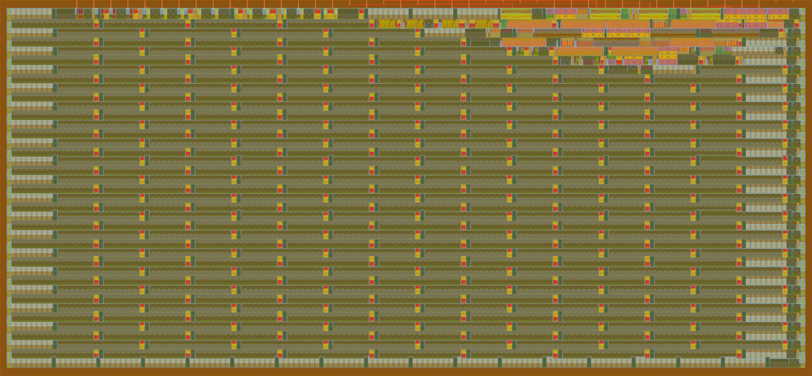

   

# TT Polygate

*Why choose a monolithic logic chip when you can have all of them in one?*

The Polygate is a configurable 4-channel logic chip that allows you the modularity of gate behaviour while keeping things acting fast in hardware (minimal register use) like a normal 74xx CMOS IC, all in the same package. The problem I was aiming to solve came down to wanting multiple, specific gates to be available in a single 74xx chip to slim down Ben Eater's breadboard CPU. Realistically, you'd need some additional logic to configure each gate anyways, but this project was less about it's utility and more about getting back into digital chip design (see my [EDLO chip](https://github.com/venomboss985/ttihp-edlo)), and hopefully getting it taped out this time. One thing I didn't do last time that I want to do this time is really polish this repository, which includes better info and usage docs, gate-level testing, and actually getting it taped out to compare simulation with reality.

## Tech Specs

### Info

* Tiles: 1x1
* Cells used: 80
* PDK: gf180mcuD
* Shuttle: TTGF26c

### Architecture

*TODO: Include architecture image*

### Features

* 4 independently configurable gate channels
* Each channel includes:
  * A and B inputs
  * Q and nQ outputs
  * Control pin for configuring the channel's logic
  * Output enable pin ()
* Gate functions include:
  * Invert (`Q = B ? ~A : A`)
  * AND (`Q = A & B`)
  * OR (`Q = A | B`)
  * XOR (`Q = A ^ B`)

## Build this project

*TODO: Test local build instructions*

1. Make sure you have Docker and VS Code installed (waiting for Zed to support dev containers ;-;)
2. Clone this repository and open in VS Code
3. Once opened, you'll be prompted to "Reopen in a Dev Container", choose yes
   * If not prompted, open the command pallette and find `> Open folder in Container`
4. Wait for the container to load
   * The first load of the dev container will be slow as its downloading necessary toolchain files
   * Subsequent loading should much shorter
5. Once the container is loaded, open a terminal and enter the following:
   1. `cd /workspaces/ttgf-polygate`
   2. `./tt/tt_tool.py --gf --create-user-config` (only need to run this once for initial hardening)
   3. `./tt/tt_tool.py --gf --harden` (run this if you need to reharden)
6. Once the chip is hardened, enter `cd test` and `make -B` to run all tests
   * For gate-level testing, refer to the [Tiny Tapeout local hardening documentation](https://tinytapeout.com/guides/local-hardening)
7. If you want to create a rendered image of the chips layout, run `cd /workspaces/ttfg-polygate` and `./tt/tt_tool.py --gf --create-png`

[Read the documentation for project](docs/info.md)

## Learning Resources

* [Tiny Tapeout](https://tinytapeout.com) (everything you need to know about this program)
* [Chip Verify](https://chipverify.com) (wonderful Verilog reference and design guides)
* [HDL Bits](https://hdlbits.01xz.net) (great tutorials to learn Verilog)
